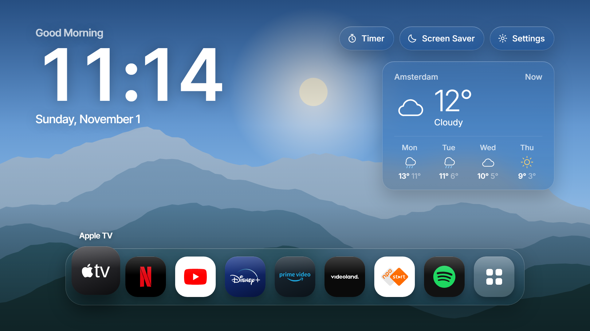
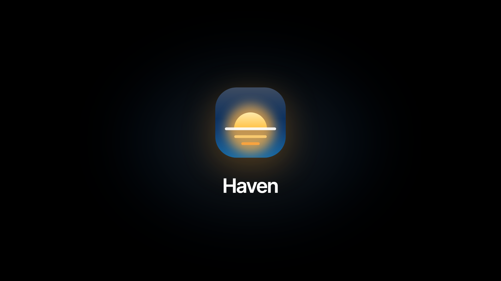
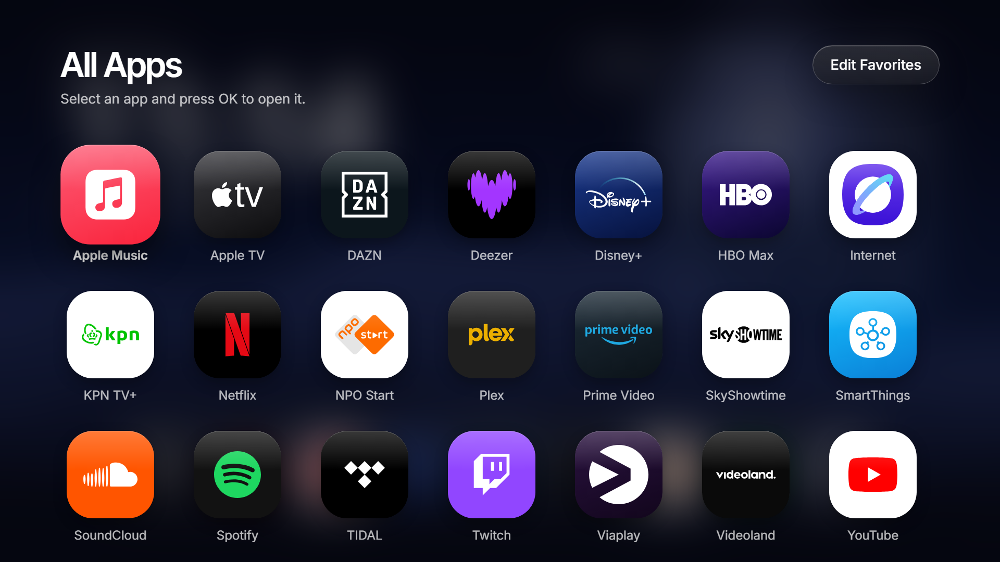
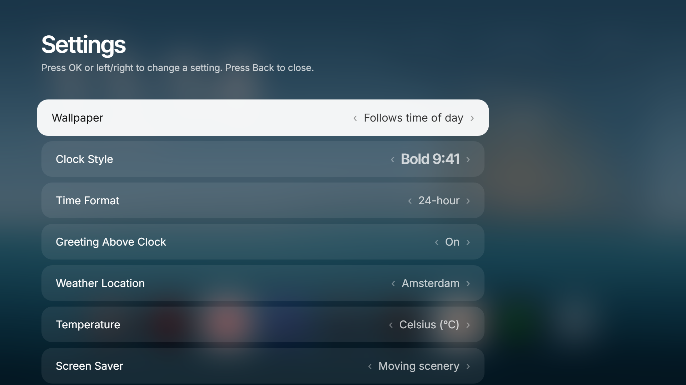
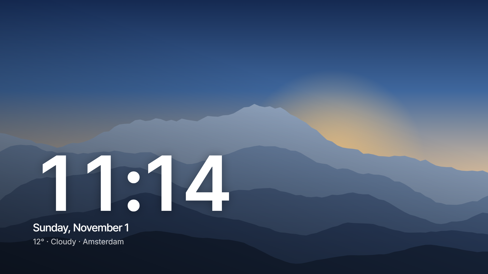

<p align="center">
  
</p>

<h1 align="center">Haven</h1>

<p align="center">
  A calm, Apple TV–inspired home screen for Samsung Smart TVs.<br>
  Clock, weather, your favorite apps, a screen saver and a kitchen timer, in one app you build and install yourself.
</p>

<p align="center">
  
</p>

---

## Why

Samsung's home screen is busy and full of ads. Haven gives you a quiet alternative: a big clock, the weather, and a dock with only the apps you actually use, on top of a slowly changing landscape.

Haven is **just an app**. It does not replace or change anything on your TV. Open it when you want it, and uninstall it like any other app if you don't.

## Features

- **Big clock** in four styles (Bold, Thin, Classic, Rounded), 12-hour or 24-hour
- **Weather** for today plus a 4-day forecast, in °C or °F (via [Open-Meteo](https://open-meteo.com), no account or API key needed)
- **Dock with up to 9 favorite apps**, launched straight from Haven
- **All Apps** screen that reads every app installed on your TV, with their own icons
- **Landscape wallpapers** drawn in code (Dawn, Day, Sunset, Night, Ocean, Desert, Graphite), or let them follow the time of day
- **Screen saver**: slowly moving scenery with the time, or a clock on black that shifts every minute to prevent burn-in
- **Kitchen timer** from 1 minute to 1 hour, with a chime when time is up
- **Startup animation and sound** (the sound can be turned off)
- **Works with the normal TV remote**: arrows, OK and Back
- **Works on older TVs too** (tested on a 2019 Samsung Q70R), with a **Screen Size** setting if your TV cuts off the edges
- **No tracking, no ads, no accounts.** The only network request is the weather.

<table>
  <tr>
    <td></td>
    <td></td>
  </tr>
  <tr>
    <td></td>
    <td></td>
  </tr>
</table>

## Try it in your browser first

You don't need a TV to see Haven. Clone the repo and start any static web server in the project folder:

```bash
git clone https://github.com/BdejongeDev/haven.git
cd haven
python -m http.server 8765
```

Open <http://localhost:8765> and use the arrow keys, Enter (OK) and Escape (Back). In the browser, Haven shows a demo list of apps. On a TV it shows your real apps.

Handy URL options for development:

| URL | What it does |
| --- | --- |
| `?nointro` | Skip the startup animation and sound |
| `?screen=apps` | Open All Apps (also `settings`, `saver`, `timer`) |
| `?wallpaper=sunset` | Force a wallpaper (`dawn`, `day`, `sunset`, `night`, `ocean`, `desert`, `graphite`) |

## Install on your Samsung TV

Haven is a Tizen web app. Installing your own app on a Samsung TV is free, but the first time takes about 30–60 minutes. You only do the setup once.

### What you need

- A Samsung Smart TV running **Tizen** (most Samsung TVs from 2017 onward)
- A Windows, macOS or Linux computer on **the same network** as the TV
- A free **Samsung account**

### 1. Install Tizen Studio

1. Download **Tizen Studio** (with IDE) from the [Tizen developer site](https://developer.tizen.org/development/tizen-studio/download) and install it.
2. Open the **Package Manager** that comes with it.
3. Under **Extension SDK**, install:
   - **TV Extensions** (the latest version)
   - **Samsung Certificate Extension**

### 2. Turn on Developer Mode on the TV

1. On the TV, open **Apps**.
2. On the remote, type **1 2 3 4 5**. A Developer Mode window appears.
3. Switch **Developer mode** to **On** and enter your computer's **IP address**.
4. Restart the TV: hold the power button until it turns off and on again.

> Find your computer's IP address with `ipconfig` (Windows) or `ifconfig` / `ip addr` (macOS/Linux). Find the TV's IP under **Settings → General → Network → Network Status → IP Settings**. Menu names vary a little between models.

### 3. Connect to the TV

1. In Tizen Studio, open **Tools → Device Manager**.
2. Click **Remote Device Manager**, then **+**, and enter the TV's IP address (port `26101`).
3. Switch the connection **on**. Your TV should appear in the device list.

### 4. Create a Samsung certificate

Samsung TVs only run apps signed with a Samsung certificate that includes the TV's ID.

1. Open **Tools → Certificate Manager** and click **+**.
2. Choose **Samsung**, then **TV**.
3. Create a new author certificate (any name and password) and sign in with your Samsung account when asked.
4. For the distributor certificate, keep the default privilege level. Make sure your **TV's DUID** is in the device list. Tizen Studio fills it in automatically while the TV is connected.

### 5. Install Haven

**Option A: Tizen Studio (easiest)**

1. **File → Import → Tizen → Tizen Project**, and select this folder. Alternatively, create a new **TV → Web Application → Basic Project** and copy all files from this repo into it, replacing the defaults.
2. Right-click the project → **Run As → Tizen Web Application**.
3. Haven installs and opens on your TV. From then on you can find it among your apps.

**Option B: command line**

```bash
# Connect to the TV (use your TV's IP address)
sdb connect 192.168.1.50

# Build a signed package (use the name of your certificate profile)
tizen package -t wgt -s MyProfile -- .

# Install it (use the device name shown by `sdb devices`)
tizen install -n Haven.wgt -t <device-name>
```

`sdb` and `tizen` live in `tizen-studio/tools` and `tizen-studio/tools/ide/bin`.

### Troubleshooting

- **The TV doesn't show up in Device Manager:** check that Developer Mode has your computer's IP, restart the TV, and make sure both are on the same network.
- **"Install failed" or a certificate error:** the certificate must be a **Samsung** certificate that includes your TV's DUID. Recreate it while the TV is connected.
- **An app won't open from Haven:** some built-in Samsung apps can't be launched by other apps. Open them from the Samsung menu instead.
- **The edges of the screen are cut off:** open **Settings → Screen Size** and press Left until everything fits (usually around 95%).
- **No weather:** the TV needs internet access, and a city must be selected in Settings.

## Using Haven

| Remote | Action |
| --- | --- |
| Arrows | Move around |
| OK | Open an app or button, or change a setting |
| Left / Right on a setting | Change the value |
| Back | Close a screen, or exit Haven from the home screen |
| Any button | Wake from the screen saver, stop the timer alarm, skip the startup animation |

**Favorites:** open **All Apps → Edit Favorites** and press OK on an app to add it to or remove it from the dock.

## Customize

Everything lives in a few plain files. No build step and no frameworks.

| File | What's in it |
| --- | --- |
| `index.html` | Page layout and the startup logo |
| `style.css` | All styling and animations |
| `app.js` | App logic: apps, dock, settings, weather, timer, screen saver, remote navigation |
| `wallpapers.js` | The landscape wallpapers, drawn as SVG in code |
| `config.xml` | Tizen app settings (name, ID, permissions) |
| `logos/` | App logos used for the tiles |
| `fonts/` | Bundled fonts, so Haven works offline |

Common tweaks in `app.js`:

- **`DEFAULTS`**: the default settings, for example `hour12: true` and `units: "f"` for the US
- **`DEFAULT_FAVS`**: which apps go in the dock on first launch
- **`HIDDEN`**: apps you never want to see in Haven
- **`CITIES`**: add your own city as `"Name": [latitude, longitude]`
- **`LOGOS`**: add a logo for an app. Put an SVG in `logos/` and add a line such as `"my app": { f: "myapp", bg: "#000", s: 60 }`. On the TV, apps without a logo here use the icon the TV provides.

## How it works

- Haven is a regular **Tizen web app** (HTML, CSS and JavaScript). It uses the Tizen APIs to list installed apps (`tizen.application.getAppsInfo`) and to open them (`tizen.application.launch`).
- Settings and favorites are stored on the TV with `localStorage`.
- Weather comes from **Open-Meteo** and refreshes every 30 minutes.
- The wallpapers, the startup chime and the timer alarm are all generated in code, so there are no image or audio files to download.

## Limitations

- Samsung doesn't allow third-party apps to **replace the home screen** or **start automatically** when the TV turns on. Haven is an app you open yourself.
- The frosted-glass blur needs a fairly recent TV. On older models the panels are see-through instead of blurred.
- Switching **HDMI inputs** and turning the TV off need permissions that Samsung only gives to partners, so Haven can't do those.

## Credits

- App logos come from [Simple Icons](https://simpleicons.org) (CC0), [SVGL](https://svgl.app), Wikimedia Commons and the services' own websites. **All logos are trademarks of their respective owners** and are only used to show which app a tile opens.
- Fonts: [Inter and Inter Tight](https://rsms.me/inter/), [Instrument Serif](https://github.com/Instrument/instrument-serif) and [Nunito](https://github.com/googlefonts/nunito), all under the [SIL Open Font License](fonts/OFL.txt).
- Weather data: [Open-Meteo](https://open-meteo.com) (CC BY 4.0).

Haven is an independent project. It is **not affiliated with Apple or Samsung**.

## License

The Haven source code is released under the [MIT License](LICENSE). Fonts and logos keep their own licenses, listed above.
